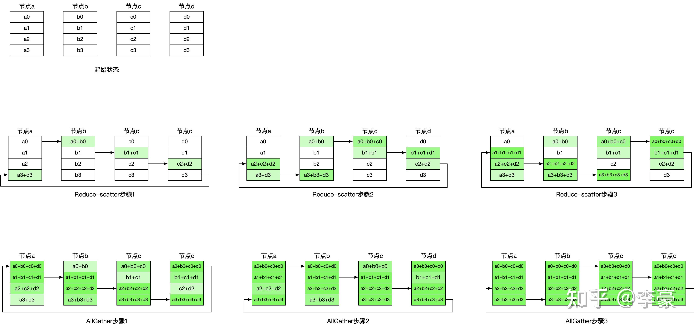
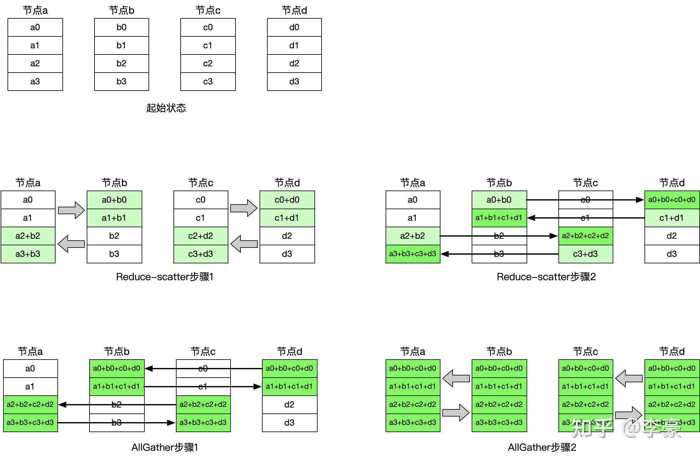

# LLM Infra

## 推理

### TensorRT 

[TensorRT文档解析（介绍）](https://developer.aliyun.com/article/995926)

### vllm

#### 简介

- vllm 为什么快？
    - PageAttention
    - Continuous Batching
    - CUDA Graphs
    - 模型量化
    - 模型并行
    - Prefix Caching
    - 推测解码

#### PageAttention

- 目的：对KVCache进行管理，解决Decoder模式中的显存碎片问题
- 过程
    - 生成之前：模型看到的实际上是逻辑的KVCache，通过`block table`完成逻辑块到物理块之间的映射
    - 分配空间并存储KVCache：Prefilling阶段把需要的显存空间分配好
    - Decode阶段: 如果现在的block还有空间，就继续写入，如果不足了，那么就申请一个新的block size并且将映射关系写入block table。

## 通信

### 集合通信概述

[一文讲清 NCCL 集合通信原理与优化](https://zhuanlan.zhihu.com/p/720502061)

#### 训练中的通信

- 数据并行

在训练过程中，每个 GPU 只存储模型的一部分 shard：

Forward Pass：通过 all-gather 将模型参数聚集到每个 GPU，然后进行前向计算。

Backward Pass：同样通过 all-gather 将模型参数聚集到每个 GPU，计算出本地梯度后，通过 reduce-scatter 将平均后的梯度分摊到各自的 GPU 上，然后进行本地的权重更新。

通过这种方法有效地降低了通信开销，提高了数据并行训练效率。

- 模型并行（分为流水并行以及张量并行）

张量并行：MHA（多头自注意力）比较适合张量并行。矩阵大小可以达到 GB 级别，一个step可能需要进行几十次通信。

流水并行：就是将输入的 batch size 切分为多个mini-batch 的数据，通过划分为多个阶段进行并行计算，掩盖计算过程中的“气泡”时间。例如Megatron

- 专家并行

专家并行的思路是将不同的专家分配到不同的 GPU 上，这有助于减少内存消耗并提高训练效率。计算前需要根据路有规则将 Token 通过 All-to-All 通信发送给不同的 Experts 所在的 GPU 进行运算

#### 通信模型

##### Broadcast
- 定义：将设备`i`上的数据传输到其他的`p-1`设备上
- 传输开销：
    - 普通传输：从设备`i`依次传输到其他的设备，不能够并行
    - 分治传输：通过一传二，二传四的方式广播，这样步数是$log_2 p$
##### Reduce
- 定义：将不同设备上的结果聚合，并存在某个设备`i`上
- 传输：通过分治思想将上述的Broadcast反过来

##### AllReduce
- 定义：将不同设备上的结果聚合，并广播到其他的设备
- 传输开销：
    - 简单方法：先reduce再broadcast
    -
[深度学习常见AllReduce算法图解](https://zhuanlan.zhihu.com/p/469942194)
[All Reduce算法汇总](https://www.cnblogs.com/yangwenhuan/p/11390823.html)

**Ring Allreduce**

该算法的优点是实现简单，能充分利用每个节点的上行和下行带宽；缺点是通信延迟随着节点数线性增加，特别是对于小包延迟增加比较明显。

**Halving-Doubling AllReduce**

该算法的优点是通信步骤较少，只有$2*\log_2 N$次（其中N表示参与通信的节点数）通信即可完成，所以其有更低的延迟。相比之下Ring算法的通信步骤是$2(N-1)$次；缺点是每一个步骤相互通信的节点均不相同，链接来回切换会带来额外开销。

**通信量与通信耗时开销**

- 通信总量：两者的通信量是一致的
- 通信耗时：Ring的通信耗时是$2(N-1)$次，Halving-Doubling的耗时是$2*\log_2 N$次

##### Gather
##### AllGather
##### Scatter

### 通信框架

#### MPI

消息传递的平台，是一种标准和规范

- MPI_Scatter 与 MPI_Bcast 的区别

`MPI_Scatter`与`MPI_Bcast`非常相似，都是一对多的通信方式，不同的是后者的0号进程将相同的信息发送给所有的进程，而前者则是将一段array 的不同部分发送给所有的进程

- `AllGather` 与 `AllReduce` 的区别

`MPI_AllGather` 是将所有的数据聚合到每个进程中。

`MPI_AllReduce` 是将所有的数据规约后聚合到每个进程中

- `RingAllReduce`

- `AllToAll` 与 `AllGather`

#### NCCL

专门为NVIDIA GPU设计的通信库，包括以下优点：

- NVLink 互连：NCCL 优化了通过 NVLink 进行的 GPU 间通信，这是 NVIDIA 高端 GPU（如 Tesla V100 和 A100）之间的高速互连技术。
- GPU 直接通信：NCCL 允许 GPU 之间直接交换数据，绕过了传统的 CPU 中转，显著减少了通信延迟。
- CUDA 集成：NCCL 与 CUDA 紧密集成，使得开发者能够在 CUDA 程序中无缝地使用 NCCL 进行高效的数据传输和同步。
- 自适应拓扑：NCCL 能够自动检测并适应不同的硬件拓扑，无论是单节点多GPU还是跨节点的多GPU环境。

GPU之间的通信方式：

- GPU Direct P2P

GPU Direct Peer-to-Peer（P2P）技术允许同一节点上的GPU直接相互通信，无需通过CPU的主机内存。GPU Direct P2P依赖于PCIe架构，允许GPU共享内存资源，从而实现高效的数据交换。

- NVLink

NVLink是NVIDIA开发的一种高速互连技术，它提供了比传统PCIe更高的带宽和更低的延迟。通过NVLink，GPU之间的数据传输不再通过PCIe总线，而是直接通过NVLink连接

- Tree 算法

其主要思想是利用二叉树中大约一半节点是叶子节点的特性，通过将叶子节点变换为非叶子节点，得到两颗二叉树，每个节点在其中一颗二叉树上是叶子节点，在另一颗二叉树上是非叶子节点。

这种方法理论上是能够提供比ring算法更低的延迟（log2N < N）。

- 节点内通信：Ring 算法适用于节点内的高速互联环境，能够高效利用带宽和拓扑结构。
- 节点间通信：Tree 算法适用于节点间的网络通信环境，能够减少延迟并具有良好的扩展性。